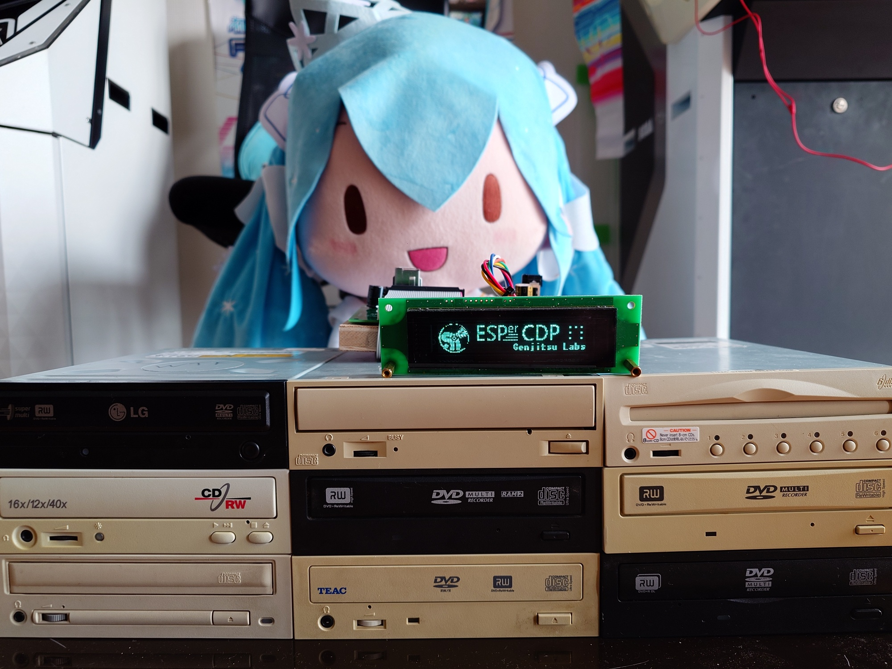

# ESPer CDP: DIY CD Player with Extra Features

## Index

* [Why a CD Player?](#why-a-cd-player)
* [The structure of an ESPer System](#the-structure-of-an-ESPer-system)
* [Contributing to ESPer](#contributing-to-esper)
* [Using ESPer in your own designs](#using-esper-in-your-own-designs)
* [Where to go further](#where-to-go-further)

## Why a CD Player?

Indeed, it is a very odd project to start in 2025, and continue in 2026. For most people listening to music is a click of a button away in a streaming service, or a local player.

I will not go into the argument of owning vs. borrowing and, frankly, I keep to a more tame stance on the question: it's fine not to own every single piece of media you consume. It's *bad* to *not have an option* to own it, but you also probably don't want to hoard every single that you're only gonna play once and forget about it the day after.

For me the reasons to create ESPer ultimately boil down to:

* **Personal Preference:** I have been collecting CDs for my entire life, with a [very sizeable number](https://www.discogs.com/user/vladkorotnev/collection) to date. My dad has been doing that as well for a good 2/3rds of his life. The CD format is tactile enough to be more interesting than a mouse click, yet convenient enough to be turned into one when the need arises, in contrast to e.g. vinyl. So a CD player to me is as essential as a fridge or a TV, for example. And sure, there are people who don't want one, or don't want a TV, and that's their choice to make.
* **Personal Preference 2:** For a while, microcontrollers in general have not been a very accessible platform. After the Arduino came out some people went as far as to make [CD-players on those](http://singlevalve.web.fc2.com/Atapiduino/atapiduino.htm), but to a newbie me back in the day the circuits looked intimidating. These days manufacturing even custom PCBs is very cheap and options to design them are ample, so it's a chance to take a spin on what I've wanted to do for years.
* **Sustainability:** While CDs are still somewhat active, the *good* players are much less so. You have the usual big brands in massive champagne colored cases which look great and work great, but priced somewhat ridiculous. If you're lucky, you can go to a second-hand store and grab an older model for a more modest price — but who knows if its' days are counted. And you have a lot of the cheaper, bottom of the barrel stuff — i.e. those modern-day players that somehow go out of their way to mess up gapless playback ("tracks" on a CD are akin to a table of contents in a book — it's a list of places where they start and end, alongside a single uninterrupted chunk of audio). Having an open platform based around a commodity item — the computer CD drive — means that as long as one of those is around and working, the player will work, too. Usually when they fail they actually need just a new belt for the tray — and if it's something more fatal then you can always just find a new one.
* **Preservation:** Some old CD drives were *nuts*. Slot loaders? Pioneer made a few, Apple had Matsushita build them for decades. 3.5-inch desktop units? Hey, I can fit [four discs in that](https://youtu.be/9ajyFVKGGHI), says Nakamichi/NEC. Hold my beer, [I'll do SIX!](https://www.instagram.com/p/DFPdWDMTqwi/), responds TEAC. And then those things become basically trash, because no modern computer can really utilize it (and let's be honest, if it can, it probably already has a way more capable drive installed in terms of supported formats). So why not have one sit on your desk and play music instead of decaying in the closet?

## The Structure of an ESPer System

The very first edition (codenamed `ESPER_OG_8M` in the firmware) used a singular, somewhat hastily routed PCB with I2C expanders for the IDE bus. This had its' flaws and strengths, but it's mostly legacy now.

The new ESPer platform going forward consists of four main parts:

1. Processor board: this is where the ESP32 lives along with the buttons and LEDs. Not sure if it's a good idea to combine the buttons onto it but for the compact build it makes more sense.
2. Drive board: this is what plugs into the drive. The flavor depends on the drive you have. The currently planned versions are:
   1. SATA Slimline: you can use this with a laptop SATA drive, because no readymade adapters exist on the market.
   2. IDE/ATAPI/PATA: comes fitted with a plug that can plug right into the drive, a pin header to use a ribbon cable, or both to allow for dual drives in a more compact way than a longer cable. A JAE KX14 50-pin connector can be fitted to use an older laptop IDE drive, or you can connect this to an off-the-shelf IDE-to-SATA translation board to use a desktop-sized SATA drive.
3. IO board: this is what provides power to the whole shebang, and also contains the DAC for the sound to come out of.
   1. Compact variant: made to fit around a laptop drive, has a USB-C 5V input, a DAC, line out 3.5mm jack, headphone jack and a headphone volume wheel.
   2. (Planned) HiFi variant: made with less thoughts given to size for use primarily with desktop drives. Triggers USB-C at 15V or takes a 12V barrel jack, and delivers a separate power line to the bigger desktop drive, while housing a DAC with an RCA line-out, an SPDIF out and a TOSLINK out. Perhaps someday also SPDIF input?
4. Display board: this houses just the display and the infrared receiver alongside it.

The infrared remote is a knockoff Sony RM-D335 with a replaced label to match the functions of the remote in the ESPer menus.

### Accessory Port

The Processor Board is equipped with an "Accessory Port". The use of that is specific to a build, but essentially it's a MOSFET-switched 5V output good for up to an amp.

The logic of it is set by the straps on the main board:

* `000`: the accessory port is active when the player is turned on, and in a non-menu state. This is a good mode to hook up a pass through relay so that another sound source can be chained on the same line for when the player is turned off.
* (planned) `001`: enables the Zoetrope mode. An LED tape installed into a window on the CD drive shall be connected to the output in this mode. When the CD mode is active and a disc is present, the LEDs pulse at a frequency roughly on par with the disc's rotation, chosen experimentally. This allows, at the right lighting conditions, to keep the CD label readable even though it spins very fast. When there is no disc, the LEDs are constantly lit at half the brightness. When a non-CD mode is active, the LEDs turn off.
* Others: reserved.

## Contributing to ESPer

While I do have somewhat strong feelings about that thing being pushed on everyone from all sides for the past few years, I also do acknowledge that in the right hands it does accelerate by a good amount without significant quality reduction. However, to achieve that, we must keep ourselves using the tool to a very high standard.

* **Please test your code.** Not as in unit-tests, but as in flash the firmware and daily drive it for a few. If you have the OG and the Neo revisions, that's awesome! If not, test on which one you have. Get a feel for how it operates, if the UX is any good or there are some annoyances in the operation of the device. If there are, please list them out and we can fix them together. **PRs from users who don't own the hardware will not be accepted in principle.**
* **No machine-generated PR body and docs.** For a non-work project like this, it's not about the hustle, but rather the communication. If you did not take care to see and read through what you want to send in and document it properly, this is insulting to everyone involved, as now the other person must dig through your code themselves to see if the text on the label matches what's actually inside the tin.
* **Machine-generated code must still be readable and understandable for a human.** Not all of us use coding agents. Not all of us can even afford them financially, and not all of us are morally comfortable with how things are right now. Comments should be *sufficient* and formatting should be *sane*. A wall of text for every line is probably not it, though [exceptions do happen](https://github.com/vladkorotnev/plasma-clock/blob/main/src/display/akizuki_k875.cpp#L240-L327) (usually the cursed parts). Something that looks like it was run through a JS minifier is definitely not it.
* **Please don't vibe-code in the bad sense of the term.** While most of the above points already cover it, still do think whether you should do something before seeing whether you can push it into the upstream.

## Using ESPer in your own designs

### Using existing PCBs

You are free to use the PCBs officially provided from this repo as files, or from myself as physical products, to build players for your friends and family. You can even do that for sale, although I would appreciate a donation in such case as well, as this has been an enormous amount of work.

In this case, just make sure you flash the right firmware with the right `FVU_FLAVOR` so that online updates work. It's probably best to install the firmware from the online updater so that it already comes with API tokens and such things used by the official upstream.

### Designing new PCBs

If the hardware matches an official board, and an existing FVU flavor can apply, then the same points as above stand.

Otherwise if you want to change e.g. the pin assignments, please fork this repository and create a new HTTP update source. The existing CI scripts should be good enough. You will then need to point the firmware to update from your server instead.

If your variant gains decent following or you plan to produce it en-masse, feel free to open an issue to add it as an officially supported flavor.

## Where to go further

* [Firmware](firm)
* [Schematics](sch)
* [Test CD files and CUE sheet](test-suite)
* [Hoard of ATAPI-related Docs](reference)
